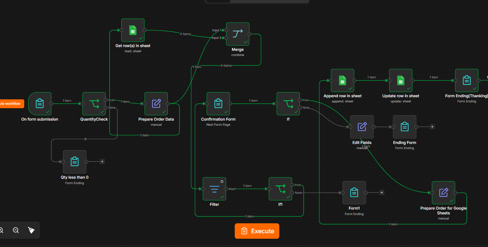
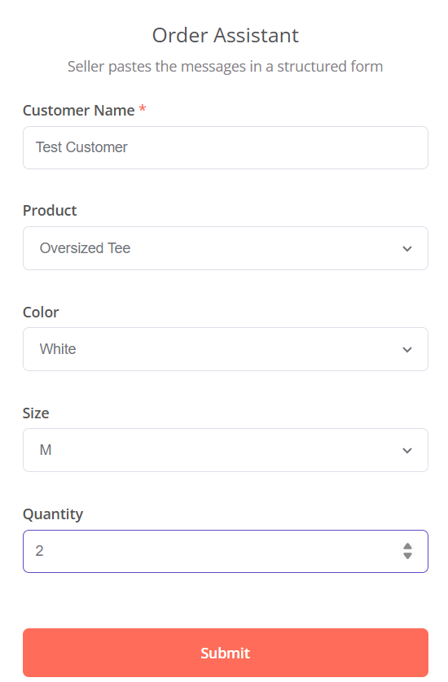
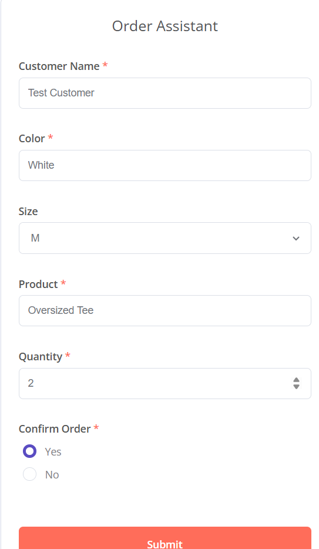
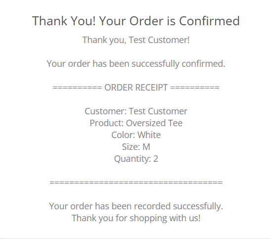
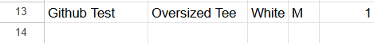
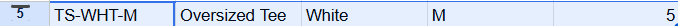
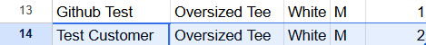
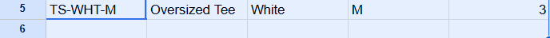

# n8n Order Management & Inventory Automation

An automated order management system built using **n8n** and **Google Sheets** to simplify customer order processing and inventory management.

## Overview

This project automates the order-handling process for a small online store. Customers submit their orders through a form, and the workflow validates product availability, checks inventory, requests customer confirmation, and updates Google Sheets automatically.

## Features

- **Customer Order Form:** Collects customer name, product, color, size, and quantity.
- **Quantity Validation:** Rejects zero and negative quantities.
- **Product Validation:** Matches requested product variants against available inventory.
- **Stock Validation:** Checks whether sufficient inventory is available.
- **Order Confirmation:** Allows customers to confirm or reject their orders.
- **Automatic Order Recording:** Adds confirmed orders to Google Sheets.
- **Inventory Management:** Automatically deducts ordered quantities from available stock.
- **Customer Feedback:** Displays appropriate messages for successful, rejected, and unavailable orders.

## Workflow

1. Customer submits an order.
2. The workflow validates the requested quantity.
3. Product, color, and size are matched against inventory.
4. Available stock is checked.
5. Customer receives an order confirmation form.
6. If confirmed, the order is recorded in Google Sheets.
7. Inventory is automatically updated.
8. The customer receives a confirmation receipt.

If the order is rejected or unavailable, the workflow displays an appropriate message without modifying inventory.

## Technologies Used

- **n8n** – Workflow automation
- **Google Sheets** – Order and inventory management
- **n8n Forms** – Customer order submission and confirmation

## Project Structure

```text
n8n-order-management-automation/
│
├── screenshots/
│   ├── workflow.png
│   ├── order-form.png
│   └── inventory-sheet.png
│
├── workflow.json
└── README.md
```

## Testing

The workflow was tested against the following scenarios:

- Successful order confirmation
- Customer rejection
- Insufficient inventory
- Nonexistent product variant
- Zero and negative quantities

All tested scenarios behaved as expected.

## Project Purpose

This project was built as a practical learning exercise to explore workflow automation, data validation, conditional logic, and integration between n8n and Google Sheets.

## Disclaimer

This is a demonstration project using sample inventory and order data. It is not currently deployed for a real business.

---

## Screenshots

### Complete Workflow


### Customer Order Form


### Order Confirmation


### Order Confirmation Receipt



### Google Sheets — Order Records(Before)


### Inventory Update(Before)


### Google Sheets — Order Records(After)


### Inventory Update(After)


**Built with n8n | Personal Automation Project**
